<p align="center">
  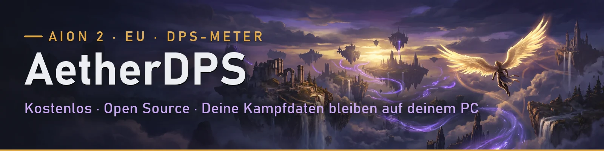
</p>

<p align="center">
  <b>Der kostenlose DPS-Meter und Begleiter für AION 2, für die EU-Server gebaut.</b><br />
  Ohne Abo, ohne Konto, ohne Werbung. Deine Kampfdaten bleiben auf deinem PC.
</p>

<p align="center">
  <a href="https://github.com/yykk62/AetherDPS/releases/latest"></a>
  <a href="https://github.com/yykk62/AetherDPS/releases"></a>
  
  <a href="LICENSE"></a>
  <a href="https://discord.gg/xExgsyDEP2"></a>
</p>

<p align="center">
  <a href="https://github.com/yykk62/AetherDPS/releases/latest"> <b>AetherDPS.exe herunterladen</b></a>
  ·
  <a href="#funktionen">Funktionen</a>
  ·
  <a href="#bedienung">Bedienung</a>
  ·
  <a href="#häufige-fragen">Häufige Fragen</a>
  ·
  <a href="https://discord.gg/xExgsyDEP2"> Discord</a>
  ·
  <a href="#in-english">English</a>
</p>

<p align="center">
  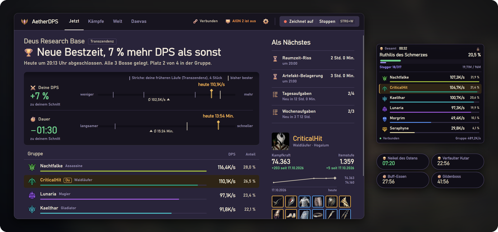
</p>

<p align="center"><sub> Deutsch · English · Français · Español · Português · Русский · 日本語 · 한국어 · 简体中文 · 繁體中文</sub></p>

## Auf einen Blick

| | |
|---|---|
| 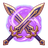 **[Live-DPS-Meter](#live-dps-meter)** | Boss mit Lebens- und Stagger-Balken, Schaden, DPS und Anteil deiner Gruppe, Skill-Details per Klick |
|  **[Läufe-Archiv](#laeufe-archiv)** | Jeder Dungeon mit Boss-Zeiten, Bestzeit und Kampfanalyse, als Bild oder Text für Discord |
| 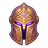 **[Profil](#profil)** | Dein Charakter (oder jeder auf einem EU-Server) ohne laufendes Spiel: Ausrüstung, Werte, Daevanion, Skills |
|  **[Neu in der Gruppe](#neu-in-der-gruppe)** | Tritt jemand bei, siehst du sofort Kampfkraft, Itemstufe, Verzauberung und Waffe |
|  **[Pet-Finder & Radar](#pet-finder-und-pet-radar)** | Alle Pets mit deiner Stufe, ihre Spawnpunkte auf der Karte und ein Radar zu den fehlenden in deiner Nähe |
|  **[Timer & Feldbosse](#timer-und-feldbosse)** | Echte Respawn-Zeiten vom Server, Risse, Belagerung, eigene Timer als Pills über dem Spiel |
|  **[Verbindung](#verbindung-und-mehr)** | Ping-Verlauf, Lag-Spitzen und die Antwort, ob es an dir, am Anbieter oder am Spielserver liegt |
|  **[Checkliste](#checkliste)** | Tägliches und Wöchentliches mit automatischem Reset und Erinnerung |
|  **Screenshot** | STRG+S zeigt das Spielbild sofort auf deinem zweiten Monitor |
|  **10 Sprachen** | Oberfläche, Skills, Monster, Klassen, Dungeons und Servernamen in deiner Sprache |
|  **Updates** | Kommen von selbst, geprüft per Prüfsumme. Nach einem Spiel-Patch sagt dir der Meter Bescheid |
|  **Discord-Profil** | Auf Wunsch sehen Freunde in Discord „AION 2 · Dungeon: …“ oder „Bosskampf: …“ mit Laufzeit, ohne Charakternamen |

## Warum AetherDPS?

-  **Das Pet-Radar ersetzt deine Karte.** Öffnest du im Spiel die Karte, liegt es genau darüber, folgt dir live (auch im Flug) und zeigt die fehlenden Pets mit Entfernung, Richtung und dem Monster, das die Seele droppt. Kein Extra-Knopf, kein Hotkey.
- 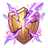 **Stagger je Spieler:** Nach jeder Stagger-Phase siehst du, ob sie geklappt hat und wer wie viel beigetragen hat.
-  **Warum laggt es?** Die Verbindungsprüfung sagt, ob es am Heimnetz, am Internetanbieter oder am Spielserver liegt.
-  **Neu in der Gruppe:** Kampfkraft, Itemstufe, Verzauberung und Waffe erscheinen, sobald jemand beitritt.
-  **Ehrlich nach Patches:** Versteht der Meter das Spiel nicht mehr, sagt er es, statt leere oder falsche Zahlen zu zeigen.
-  **Deine Daten bleiben bei dir:** keine Uploads, keine Bestenlisten, kein Konto.

## Funktionen

<a name="live-dps-meter"></a>
<p align="center">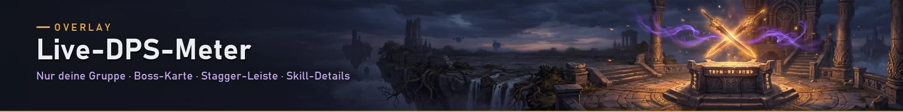</p>

<table>
  <tr>
    <td width="52%">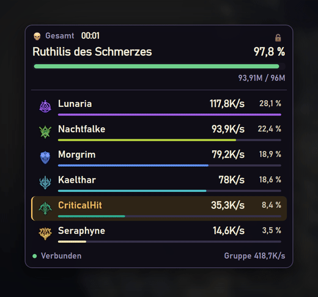</td>
    <td>

Das Overlay liegt über dem Spiel und zeigt **nur deine Gruppe**: Fremde in der Nähe erscheinen nie, Beschwörungen zählen zu ihrem Besitzer.

- **Boss-Karte** mit Lebensbalken und **Stagger-Leiste**
- Schaden, **DPS** und **Anteil** jedes Mitglieds, Klassen-Icons und -Farben
- **Gesamt** (ganzer Dungeon seit STRG+W) oder nur das **aktuelle Ziel**
- **Auto-Modus:** klappt bei jedem Boss von selbst auf
- **Sperren:** Klicks gehen ins Spiel, nichts wird versehentlich angeklickt
- **Platzieren:** STRG+P zeigt alle Overlays mit Beispieldaten in echter Größe, sie rasten am Rand und aneinander ein
- Der Dungeon wird erkannt (mit Schwierigkeit)

</td>
  </tr>
  <tr>
    <td>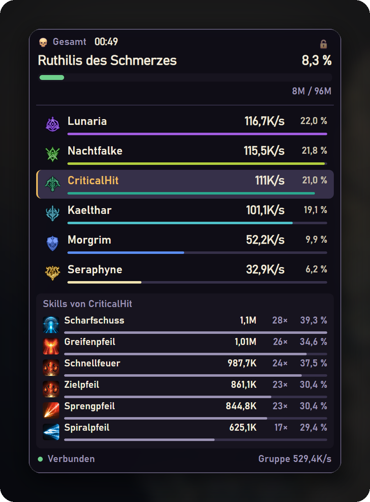</td>
    <td>

** oder Klick auf einen Spieler** zeigt seine Skills mit Schaden, Treffern und Krit-Quote, direkt im Overlay.

Nach deinem Tod zeigt der Meter, **woran du gestorben bist**, und läuft ein langer Buff aus, sagt er Bescheid.

</td>
  </tr>
</table>

<a name="laeufe-archiv"></a>
<p align="center"></p>

Jeder Lauf wird nach dem Dungeon benannt und mit Boss-Zeiten gespeichert.  markiert deine **Bestzeit**, daneben steht der Vergleich mit deinem Durchschnitt. Die **Kampfanalyse** zeigt pro Spieler Aktivität, Tode, erlittenen Schaden, Schaden nach Skill und Buff-Laufzeit. **Als Bild kopieren**, als Text oder per Klick in deinen eigenen Discord-Kanal.

<p align="center">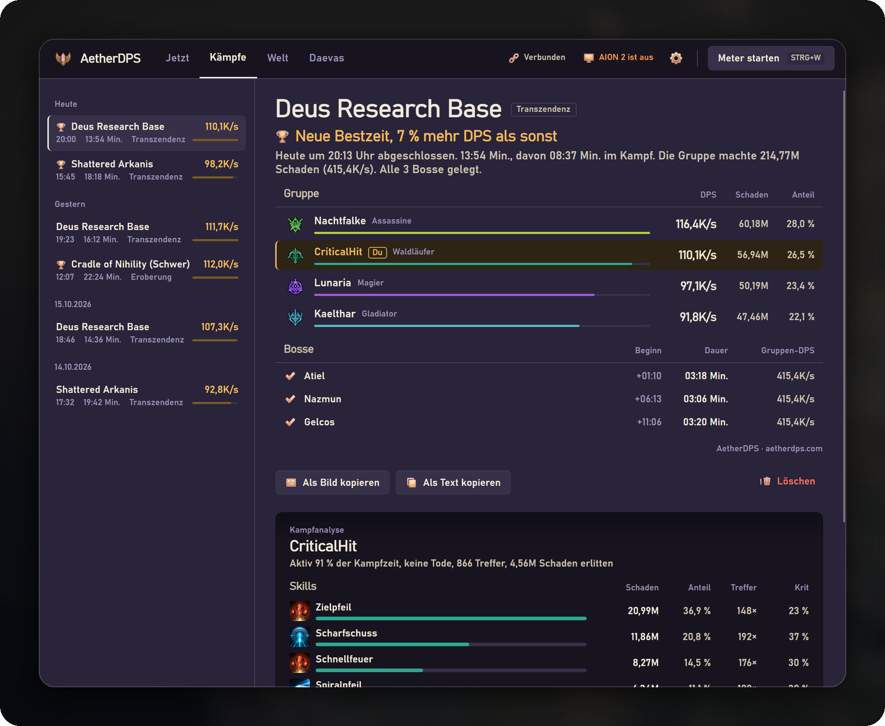</p>

<a name="profil"></a>
<p align="center">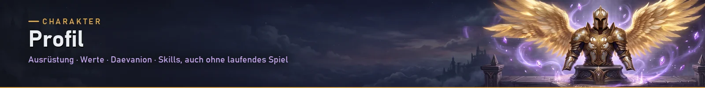</p>

Dein Charakter auf einen Blick, **auch ohne laufendes Spiel**: Kampfkraft, Itemstufe, mittlere Verzauberung, die komplette Ausrüstung, alle Werte mit ihren Wirkungen, Daevanion-Fortschritt je Brett, Titel, Pet, Flügel, Skills und Stigma-Skills. Jeden anderen Charakter auf einem EU-Server findest du per Name. Die Daten sind dieselben öffentlichen wie auf aion2.plaync.com.

<p align="center">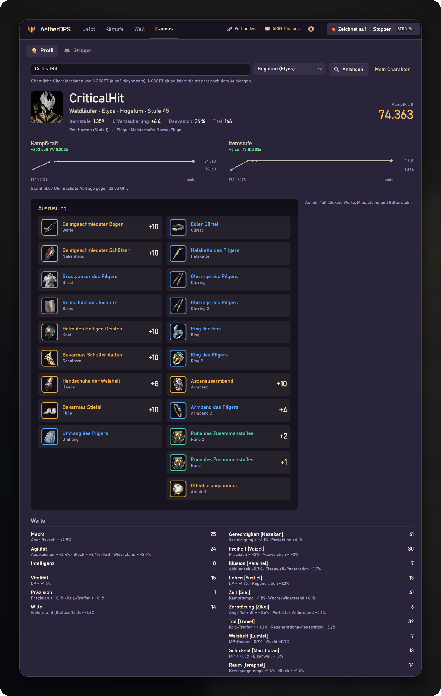</p>

<details>
<summary><b>Klick auf ein Teil:</b> Werte, Manasteine und Götterstein</summary>
<br />
<p align="center">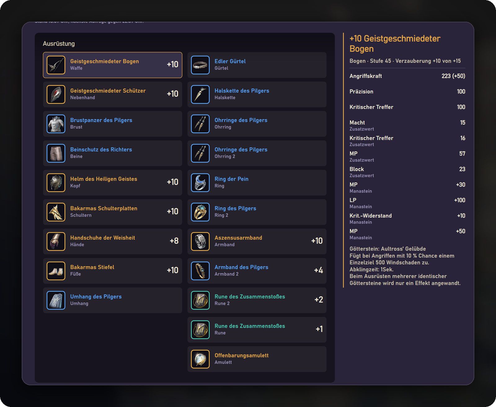</p>
</details>

<details>
<summary><b>Weiter unten:</b> Daevanion, Titel, Skills und Stigma-Skills</summary>
<br />
<p align="center">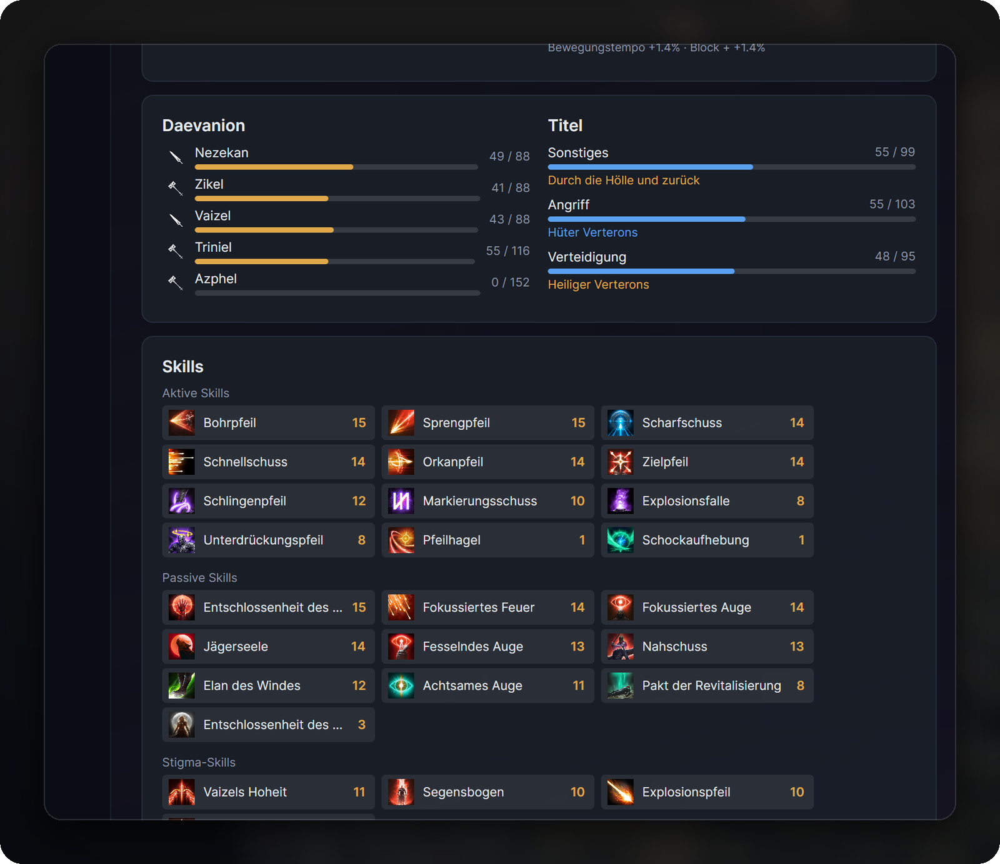</p>
</details>

<a name="neu-in-der-gruppe"></a>
<p align="center">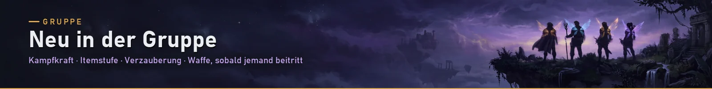</p>

Tritt jemand deiner Gruppe bei, erscheint am Bildschirmrand seine Karte mit **Kampfkraft, Itemstufe, Verzauberung, Daevanion und Waffe**. Ein Klick öffnet das ganze Profil. Abschaltbar im Reiter Gruppe. Verfehlt die Gruppe einen Stagger, zeigt der Meter, wer wie viel beigetragen hat.

<p align="center">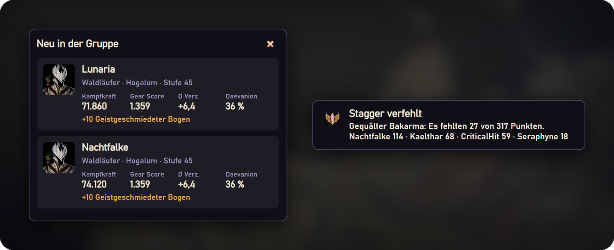</p>

<a name="pet-finder-und-pet-radar"></a>
<p align="center">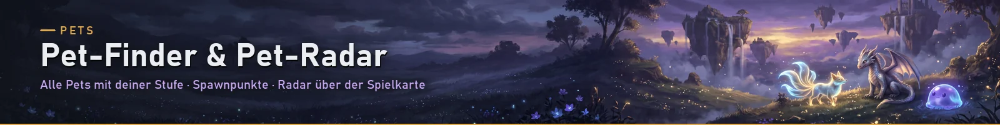</p>

Alle Pets von Verteron, Altgard und der Abyss mit **deiner Stufe und deinem Fortschritt** (liest der Meter beim Einloggen mit), mit Bild und einer Karte aller Spawnpunkte ihrer Monster, samt Gebieten und deiner Position. Filter nach Gattung und Status, Suche nach Pet oder Monster. Jede Gattung hat ihre Farbe: Cognia blau, Fera orange, Natura grün, Varia lila, Specia gelb.

<p align="center">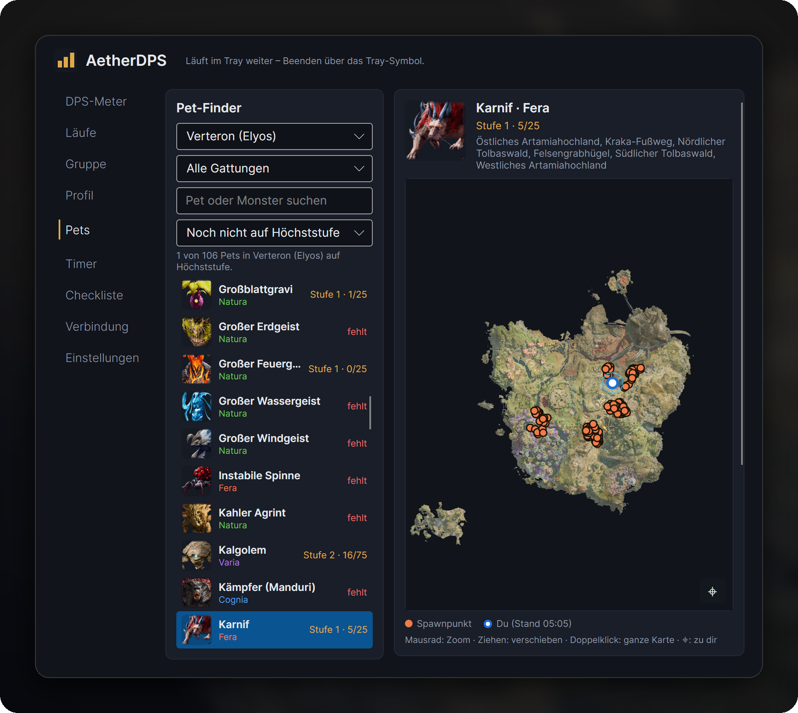</p>

Das **Pet-Radar** erscheint, sobald du im Spiel die Karte öffnest, genau darüber und so groß wie sie, oder bleibt auf Wunsch dauerhaft stehen. Es ist eine **Minimap wie im Spiel**: Du bist immer in der Mitte, sie folgt dir (auch im Flug) und merkt sich deinen Zoom. Darauf die fehlenden Pets in deiner Nähe mit **Entfernung, Richtung und dem Monster, das die Seele droppt**. Klick auf ein Pet zeigt seine Fundorte; liegt keiner im Bild, zoomt die Karte nur so weit heraus, dass der nächste zu sehen ist. Alle Knöpfe liegen klein auf der Karte;  blendet die Liste aus,  klappt das Radar zu einer kleinen Leiste ein, die Ecke unten rechts ändert die Größe.

<table>
  <tr>
    <td width="42%">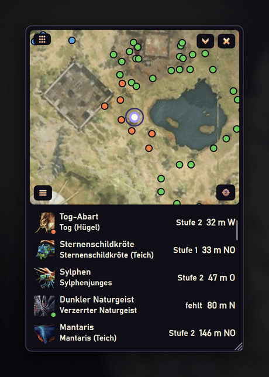</td>
    <td>

**Unterwegs:** Du fliegst los, die Minimap bleibt auf dir und die Entfernungen zählen mit. Unter jedem Pet steht das Monster am nächsten Fundort, denn die Seele heißt oft anders als das Monster (die Bienen-Abart droppt z. B. von der Schwarzmusterbiene).

Ein Klick auf ein Pet zeigt nur noch seine Fundorte, nochmal klicken bringt das Radar zurück. Der Punkt am Bild zeigt die Farbe auf der Karte.

</td>
  </tr>
</table>

<p align="center">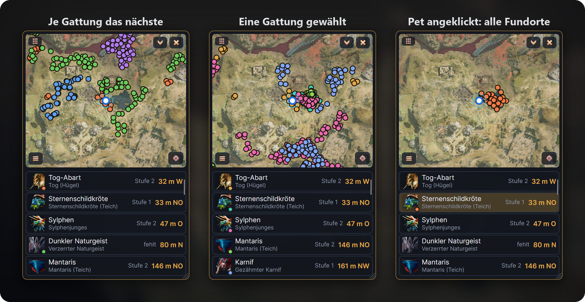</p>

<a name="timer-und-feldbosse"></a>
<p align="center">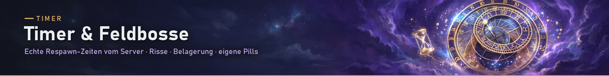</p>

Öffnest du im Spiel die Karte, schickt der Server die Feldbosse mit ihren **genauen Respawn-Zeiten**, und der Meter merkt sie sich. Dazu Raumzeit-Risse, Artefakt-Belagerung und eigene Countdowns, alle mit Erinnerung. Im Dungeon läuft das Zeitlimit mit.

<table>
  <tr>
    <td width="50%">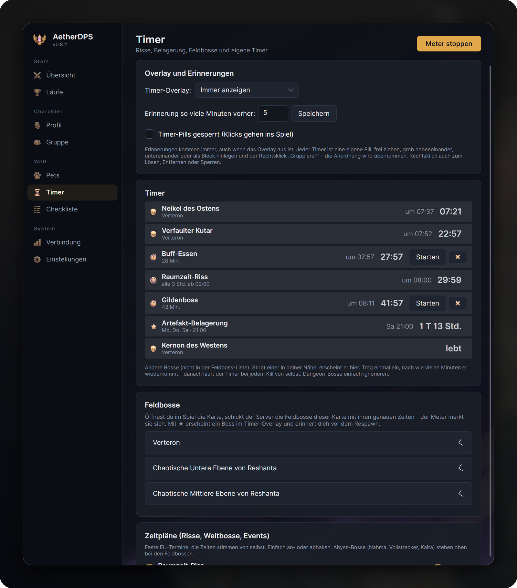</td>
    <td>

Jeder Timer ist eine eigene **Pill** über dem Spiel:

- im Platzierungsmodus (**STRG+P**) grob **nebeneinander, untereinander oder als Block** hinlegen
- Rechtsklick → **Gruppieren**: Die Anordnung wird übernommen (1×3, 3×1, 2×2 …)
- Rechtsklick auch zum **Lösen**, **Entfernen** oder **Sperren**, ohne die App zu öffnen

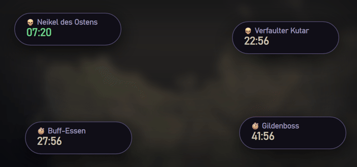

</td>
  </tr>
</table>

<a name="verbindung-und-mehr"></a>
<p align="center">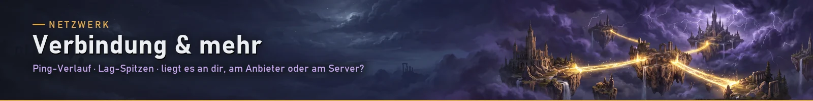</p>

Der Reiter Verbindung zeigt deinen Spiel-Ping als Verlauf mit Lag-Spitzen und neu gesendeten Paketen. **Verbindung prüfen** sagt dir, ob ein Problem im Heimnetz, beim Internetanbieter oder auf dem Weg zum Spielserver liegt.

**Im Discord-Profil anzeigen** (Einstellungen → Datenschutz, standardmäßig aus): Freunde und deine Gilde sehen in Discord, was du gerade machst, z. B. „AION 2 · Dungeon: Draupnir“, „Bosskampf: …“ oder „In Bereitschaft“, mit Laufzeit und Knöpfen zum Herunterladen und zu unserem Discord. Dungeon- und Bossnamen lassen sich ausblenden, Spieler- und Charakternamen erscheinen nie.

<p align="center">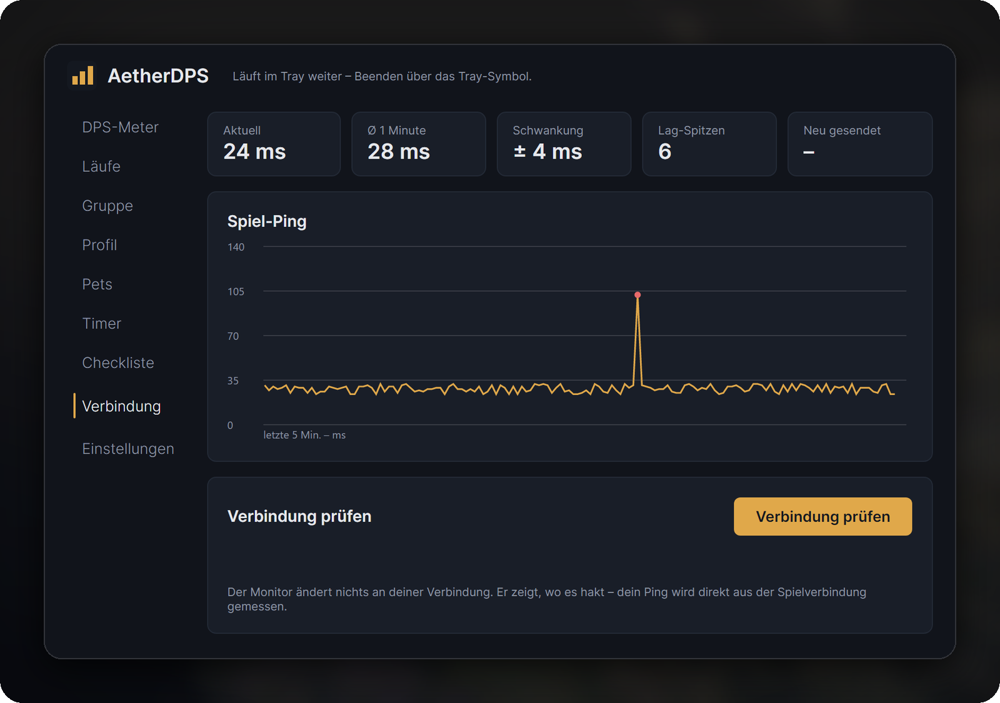</p>

## Häufige Fragen

**Ist das erlaubt?** Der Meter liest den Netzwerkverkehr nur **passiv** mit, so wie die Spieltools anderer Anbieter auch. Er verändert nichts am Spiel, liest keinen Spielspeicher und sendet nichts ans Spiel. Es ist ein inoffizielles Fan-Projekt, nicht mit NCSOFT verbunden. Die Nutzung erfolgt auf eigene Verantwortung.

**Was kostet das?** Nichts. Der Quellcode ist offen (GPL-3.0), jeder kann nachsehen, was das Programm tut.

**Werden meine Daten hochgeladen?** Deine Kampfdaten, Läufe und Mitschnitte nie. Es gibt kein Konto und keine Bestenliste. Nach außen geht nur:
- die **Update-Prüfung** und das Lesen von Neuigkeiten auf GitHub (es wird nichts gesendet),
- eine **anonyme Nutzungszahl**, nur wenn du beim ersten Start zustimmst: einmal am Tag `{"v":"0.7.4","lang":"de","new":false}`, also Version, Sprache und ob es die erste Nutzung ist. Keine Namen, kein Server, keine Kennung. Jederzeit abschaltbar unter Einstellungen → Datenschutz,
- **Fehlerberichte**, nur wenn du selbst auf „Senden“ klickst. Namen von Spielern werden vorher entfernt, und du siehst vorher, was rausgeht.
- **Charakter-Profile** von NCSOFT (dieselben öffentlichen Daten wie auf aion2.plaync.com): wenn du den Reiter Profil öffnest (dein Charakter), auf jemanden klickst oder sucht, – abschaltbar im Reiter Gruppe – wenn jemand deiner Gruppe beitritt, und – abschaltbar unter Einstellungen → Datenschutz – alle 4 Stunden dein eigenes Profil, solange der Meter läuft (für deinen Verlauf von Kampfkraft und Itemstufe, der nur auf deinem PC liegt). Dabei gehen nur Name und Server an NCSOFT.
- **Skill- und Item-Bilder** direkt von NCSOFT (assets.playnccdn.com), z. B. in der Kampfanalyse. Jedes Bild wird einmal geladen und dann im Datenordner aufbewahrt; dabei wird nichts von dir gesendet.
- **Discord-Profil**, nur wenn du es unter Einstellungen → Datenschutz einschaltest: Der Meter sagt dem Discord auf deinem PC (lokal, nicht über das Internet und nicht über uns), was du gerade machst, z. B. „AION 2 · Dungeon: Draupnir“. Discord zeigt das dann wie bei jedem Spiel in deinem Profil. Keine Spieler- oder Charakternamen, keine Kampfdaten; Dungeon- und Bossnamen lassen sich ausblenden.

Der Server dafür ist offen einsehbar im Ordner [`server/`](server/) und speichert keine IP-Adressen. Gegen Spam zählt er je Absender höchstens einen Ping und fünf Berichte pro Tag; dafür merkt er sich bis Tagesende nur einen Hash mit täglich neuem Zufallswert, der danach gelöscht wird.

**Warum warnt Windows beim ersten Start?** Die Datei ist noch nicht digital signiert, das ist in Arbeit. Klick auf „Weitere Informationen“ → „Trotzdem ausführen“.

**Was ist Npcap?** Ein kostenloser Treiber, mit dem Programme den Netzwerkverkehr mitlesen können (auch Wireshark nutzt ihn). Der Meter richtet ihn beim ersten Start mit einem Klick ein.

**Etwas stimmt nicht?** Hauptfenster oder Tray-Symbol → „Problem melden“. Kurz beschreiben, Senden klicken, fertig. Kein Konto und keine E-Mail nötig. Alternativ ein [Issue auf GitHub öffnen](https://github.com/yykk62/AetherDPS/issues).

**Nach einem Spiel-Patch zeigt der Meter nichts mehr?** Das passiert, wenn sich die Daten des Spiels ändern. Der Meter erkennt das und sagt Bescheid. Die angepasste Version kommt meist schnell und installiert sich von selbst.

## Download

**[AetherDPS.exe von der Release-Seite laden](https://github.com/yykk62/AetherDPS/releases/latest)**: eine einzige Datei, keine Installation und kein .NET nötig.

- **Voraussetzung:** Windows 10 oder 11 (64 Bit) und Npcap (richtet der Meter beim ersten Start selbst ein)
- **Wohin damit?** In einen eigenen Ordner, zum Beispiel `Dokumente\AetherDPS`, nicht in den Download-Ordner und nicht nach `C:\Programme` (dort darf sich die Datei nicht selbst aktualisieren)
- **Windows-Warnung „Der Computer wurde durch Windows geschützt“:** Die Datei ist noch nicht digital signiert. Auf „Weitere Informationen“ → „Trotzdem ausführen“ klicken. Wer sichergehen will, vergleicht die SHA-256-Prüfsumme mit der Angabe auf der Release-Seite: `Get-FileHash AetherDPS.exe`
- **Updates kommen automatisch:** Der Meter sieht bei jedem Start auf GitHub nach und installiert eine neue Version gleich dort (er startet kurz neu). Läuft er länger, schaut er stündlich nach und installiert beim nächsten Start. Abschaltbar unter Einstellungen → Updates. Dabei wird nur die öffentliche Release-Seite abgefragt, von dir wird nichts gesendet

## Installation

1. AetherDPS starten.
2. Fehlt **Npcap**, öffnet sich die Einrichtung. Dort einmal auf „Npcap jetzt installieren“ klicken. Der Meter lädt Npcap von der offiziellen Seite, prüft die Signatur und startet den Installer mit den richtigen Einstellungen. Du bestätigst nur noch (Admin-Abfrage → „Ja“, dann „I Agree“ → „Install“ → „Finish“).
3. AION 2 starten und einloggen. Das Overlay findet die Verbindung von selbst.

Die Einstellungen, die Kampf-Historie, die Logs und die Mitschnitte liegen unter `%LOCALAPPDATA%\AetherDPS`.

## Bedienung

**Orte im Hauptfenster** (oben, auch mit STRG+1 bis STRG+4; der Meter-Schalter steht rechts und zeigt, ob er aufzeichnet):
- **Jetzt:** nach einem Lauf das Urteil („Neue Bestzeit, 8 % mehr DPS als sonst“), deine DPS und Zeit auf einer Messlatte gegen deine früheren Läufe, Gruppe und Bosse; daneben, was als Nächstes ansteht
- **Kämpfe:** alle Läufe nach Tagen, Bestzeit , Kampfanalyse pro Spieler, „Als Bild/Text kopieren“ für Discord, Löschen mit „Rückgängig“
- **Welt:** Timer mit Feldbossen ( = als Pill anzeigen und erinnern), Risse, Artefakt-Belagerung und eigene Countdowns · <a name="checkliste"></a>Checkliste (täglich und wöchentlich, automatischer Reset, Erinnerung) · Pets mit Fortschritt, Karte und Pet-Radar
- **Daevas:** dein Profil oder jeder andere Charakter auf einem EU-Server, dazu die aktuelle Gruppe (Klick öffnet das Profil, „Neu in der Gruppe“ abschaltbar)
- **Verbindung** klappt beim Statusfeld oben auf, **Einstellungen** (Zahnrad oder STRG+,) kommen als Blatt von rechts

Wer das Hauptfenster schließt, lässt den Meter im Tray weiterlaufen.

| Was | Wie |
|---|---|
| Meter starten / ausblenden | **STRG+W** im Spiel (in den Einstellungen änderbar). Ohne STRG+W ist der Meter in Bereitschaft und zeichnet keine Kämpfe auf |
| Automatisch erfassen | Einstellungen → „Automatisch erfassen“. Der Meter bleibt als schmale Leiste mit Name und Server stehen und klappt bei jedem Bosskampf von selbst auf. STRG+W blendet ihn dann nur ein und aus |
| Knöpfe | erscheinen, sobald die Maus über dem Meter ist |
| Overlays platzieren | **STRG+P** im Spiel (änderbar),  am Meter oder Tray-Symbol. Kampfanzeige, Timer, Pet-Radar und Stagger-Warnung erscheinen zugleich mit Beispieldaten; ziehen, sie rasten am Bildschirmrand und aneinander ein. **Esc** oder **Enter** legt sie fest. Die Overlays nehmen dabei nie den Fokus |
| Overlays nach Lage | Einstellungen → Meter: außerhalb von Dungeons die Timer, im Dungeon die Kampfanzeige, im Bosskampf zusätzlich die Stagger-Warnung |
| Breite ändern | rechten Rand ziehen. Die Höhe passt sich der Gruppe an |
| Gesamt / Ziel | Knopf oben. **Gesamt** = aller Schaden seit STRG+W, zum Beispiel ein ganzer Dungeon. **Ziel** = nur der aktuelle Gegner |
| Zurücksetzen |  |
| Ausblenden (Bereitschaft) | . Ganz beenden über das Tray-Symbol → „Beenden“ |
| Skill-Details |  oder auf einen Spieler klicken |
| Sperren (Mausklicks gehen ins Spiel) |  Schloss-Symbol. Zum Entsperren wieder aufs Schloss klicken, es bleibt immer klickbar |
| Timer-Pills | verschieben im Platzierungsmodus; Rechtsklick → Gruppieren, Lösen, Entfernen, Sperren. Entsperren im Reiter Timer |
| Pet-Radar | erscheint mit der Spielkarte (Reiter Pets: auch „Immer“). Mausrad zoomt (wird gemerkt), Ziehen schaut kurz woanders hin, nach 5 s ist die Karte wieder bei dir. Knöpfe auf der Karte:  Overlays platzieren,  einklappen,  bis zum nächsten Öffnen ausblenden,  Liste ein/aus,  zu dir. Größe über die Ecke unten rechts |
| Einstellungen |  oder Tray-Symbol: Hotkey ändern, Deckkraft, nur meine Gruppe (Standard: an), „Du“ statt Name |
| Screenshot auf den Zweitbildschirm | **STRG+S** im Spiel (änderbar). Der Spiel-Bildschirm erscheint im Vollbild auf dem anderen Monitor, jeder neue ersetzt das alte Bild. Klick oder ESC blendet aus |
| AION 2 starten | Knopf im Hauptfenster oder Einstellung „AION 2 mit dem Meter starten“ (Steam). Läuft der Meter beim Login schon, kennt er deinen Charakter sofort |
| Fehler melden | Hauptfenster oder Tray-Symbol → „Problem melden“ |
| Sprache | Einstellungen → Sprache (Standard: wie Windows) |

## Für Entwickler

```
dotnet build AetherDPS.slnx
dotnet test AetherDPS.Tests
dotnet test AetherDPS.UiTests      # rendert alle Fenster unsichtbar; AETHERDPS_SHOTS=<ordner> speichert Bilder
AetherDPS.App\bin\Debug\net10.0\AetherDPS.exe --replay <mitschnitt.txt> [--speed 1]
AetherDPS.Cli\bin\Debug\net10.0\aetherdps-cli.exe replay|demo <datei>
```

Aufbau und Wartung stehen in [docs/WARTUNG.md](docs/WARTUNG.md), das Protokoll in [docs/PROTOKOLL.md](docs/PROTOKOLL.md). Der kleine Server für Nutzungszahl und Fehlerberichte liegt in [`server/`](server/) (Cloudflare Worker), Nachrichten an alle stehen in [`status.json`](status.json).

**Bilder fürs README** (`docs/media/`): `AETHERDPS_README=<ordner>` setzen (optional `AETHERDPS_README_FROM=%LOCALAPPDATA%\AetherDPS` für den eigenen Charakter mit echtem Profil), `dotnet test AetherDPS.UiTests --filter ReadmeMedia`, dann `python tools/readme-media.py <ordner>` (Pillow, ffmpeg).

**Release bauen:** `powershell -ExecutionPolicy Bypass -File tools\release.ps1` → `artifacts\release\AetherDPS.exe` + `.sha256`.
**Veröffentlichen:** Version in `AetherDPS.App.csproj` und `CHANGELOG.md` eintragen, dann `git tag v0.2.0` und `git push origin v0.2.0`. GitHub Actions baut, testet und legt das Release an.

## Danke an

- **[RATmeter](https://github.com/Kuroukihime/AIon2-Dps-Meter)** von Kuroukihime (GPL-3.0): die Grundlage. AetherDPS ist ein Fork davon (Netzwerkmitschnitt, Paketverarbeitung, Kampf-Sessions, Skill- und Mob-Daten)
- **[A2Tools](https://github.com/taengu/A2Tools-DPS-Meter)** von taengu (GPL-3.0): Spieltexte in 10 Sprachen und die Dungeon-Erkennung
- **[Aion-DPS-Meter](https://github.com/SkeeveAN/Aion-DPS-Meter)** von SkeeveTV (MIT): Pet-Daten, Spawnpunkte, Weltkarten und Feldboss-Positionen

Alles mit Lizenzen steht in [THIRD-PARTY-NOTICES.md](THIRD-PARTY-NOTICES.md). Klassen-Icons, Weltkarten, Pet-Porträts sowie Item- und Skill-Icons: © NCSOFT, als Fan-Inhalt verwendet; sie fallen nicht unter die GPL.

## In English

**AetherDPS** is a free, open-source DPS meter and companion overlay for AION 2, built for the EU servers and available in 10 languages (Settings → Language). The screenshots above show the German interface.

**Why AetherDPS?** The pet radar replaces your in-game map: it opens right on top of it, follows you live and shows the missing pets with distance, direction and the monster that drops the soul, no extra button needed. After every stagger phase you see who contributed how much. The connection check tells you whether lag comes from your home network, your ISP or the game server. And your data stays on your PC: no uploads, no leaderboards, no account.

- **Live DPS meter** with boss card, health and stagger bars, damage, DPS and share for your party only, skill details and death recap
- **Run archive** named after the dungeon, with boss times, best time and combat analysis, copyable as image or text for Discord
- **Profile** of your character (or anyone on an EU server) even without the game running: gear with manastones and godstone, stats, Daevanion, titles, skills and stigmas
- **Party join cards:** when someone joins, their combat power, item level, enchant level and weapon pop up
- **Pet finder:** every pet with your level and a map of where its monsters spawn, plus your position. The **pet radar** opens with the in-game map (or stays on) and shows the missing pets around you with distance and direction, colour-coded by species
- **Field bosses with the server's real respawn times** (just open the map in game), rifts, Artifact Siege, dungeon time limit, custom timers as **draggable pills** you can group with a right-click
- **Discord profile** (opt-in): friends see “AION 2 · Dungeon: …” or “Boss fight: …” with elapsed time in your Discord profile, never character names
- **Checklist**, **connection monitor**, **second-screen screenshot**, **automatic updates**, a warning after game patches, and **Report a problem** straight from the app

**Download:** [AetherDPS.exe](https://github.com/yykk62/AetherDPS/releases/latest), a single file with no installation needed (Windows 10/11, 64-bit). On first start it sets up Npcap with one click.

**Privacy:** your combat data never leaves your PC. The only outgoing data is the update check, an optional anonymous daily usage count (version and language only, opt-in), problem reports you send yourself and character profile lookups at NCSOFT (name and server only: when you open the Profile tab, look someone up, – switchable – when someone joins your party, and – switchable – your own profile every 4 hours while the meter runs, for your local combat power history). Skill and item icons are loaded once from NCSOFT (assets.playnccdn.com) and kept in the data folder. If you turn on the Discord profile, the meter tells the Discord app on your PC (locally, not through us) what you are doing, without player or character names. The server code is in [`server/`](server/); it stores no IP addresses and counts at most one ping per sender per day.

**Is it allowed?** The meter only reads network traffic passively. It does not modify the game, read game memory or send anything to the game. It is an unofficial fan project, not affiliated with NCSOFT. Use at your own risk.

## Lizenz

GPL-3.0, siehe [LICENSE](LICENSE).
