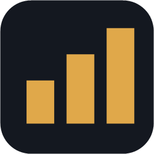

<p align="center">
  
</p>

<h1 align="center">AION 2 Meter</h1>

<p align="center">
  <b>Der kostenlose DPS-Meter und Begleiter für AION 2, auf Deutsch und für die EU-Server gebaut.</b><br />
  Ohne Abo, ohne Konto, ohne Werbung. Alles bleibt auf deinem PC.
</p>

<p align="center">
  <a href="https://github.com/yykk62/Aion2Meter/releases/latest"><b>⬇ Aion2Meter.exe herunterladen</b></a>
  ·
  <a href="#bedienung">Bedienung</a>
  ·
  <a href="#häufige-fragen">Häufige Fragen</a>
</p>

<p align="center">
  
</p>

## Was kann der Meter?

| | |
|---|---|
| ⚔ **DPS-Meter** | Schaden, DPS und Anteil für jedes Gruppenmitglied als Overlay über dem Spiel. Skill-Details per Klick. Start und Stopp mit STRG+W |
| 👥 **Nur deine Gruppe** | Fremde in der Nähe erscheinen nie. Beschwörungen zählen zu ihrem Besitzer |
| 🏆 **Läufe-Archiv** | Jeder Dungeon mit Boss-Zeiten, Bestzeit und Kampfanalyse, als Bild oder Text für Discord kopierbar |
| ⏱ **Timer-Overlay** | Risse, Weltbosse, Events und Feldbosse mit Erinnerung, frei anpassbar |
| ✅ **Checkliste** | Tägliches und Wöchentliches mit automatischem Reset |
| 📶 **Verbindung** | Ping-Verlauf, Lag-Spitzen und eine Prüfung, ob das Problem bei dir, beim Anbieter oder beim Spielserver liegt |
| 🖼 **Screenshot** | STRG+S zeigt das Spielbild sofort auf deinem zweiten Monitor |
| 🔄 **Updates** | Neue Versionen kommen von selbst, geprüft per Prüfsumme |

## Häufige Fragen

**Ist das erlaubt?** Der Meter liest den Netzwerkverkehr nur **passiv** mit, so wie die Spieltools anderer Anbieter auch. Er verändert nichts am Spiel, liest keinen Spielspeicher und sendet nichts ans Spiel. Es ist ein inoffizielles Fan-Projekt, nicht mit NCSOFT verbunden. Die Nutzung erfolgt auf eigene Verantwortung.

**Was kostet das?** Nichts. Der Quellcode ist offen (GPL-3.0), jeder kann nachsehen, was das Programm tut.

**Werden meine Daten hochgeladen?** Nein. Es gibt kein Konto, keine Telemetrie und keine Bestenliste. Die einzige Verbindung nach außen ist die Update-Prüfung auf GitHub, und die lässt sich abschalten.

**Warum warnt Windows beim ersten Start?** Die Datei ist noch nicht digital signiert, das ist in Arbeit. Klick auf „Weitere Informationen“ → „Trotzdem ausführen“.

**Was ist Npcap?** Ein kostenloser Treiber, mit dem Programme den Netzwerkverkehr mitlesen können (auch Wireshark nutzt ihn). Der Meter richtet ihn beim ersten Start mit einem Klick ein.

**Etwas stimmt nicht?** Tray-Symbol → „Problem melden“ speichert die letzten 5 Minuten. Dann ein [Issue öffnen](https://github.com/yykk62/Aion2Meter/issues) und die Datei anhängen. Achtung: Darin stehen die Namen der Spieler um dich herum.

## Download

**[Aion2Meter.exe von der Release-Seite laden](https://github.com/yykk62/Aion2Meter/releases/latest)**: eine einzige Datei, keine Installation und kein .NET nötig.

- **Voraussetzung:** Windows 10 oder 11 (64 Bit) und Npcap (richtet der Meter beim ersten Start selbst ein)
- **Wohin damit?** In einen eigenen Ordner, zum Beispiel `Dokumente\Aion2Meter`, nicht in den Download-Ordner und nicht nach `C:\Programme` (dort darf sich die Datei nicht selbst aktualisieren)
- **Windows-Warnung „Der Computer wurde durch Windows geschützt“:** Die Datei ist noch nicht digital signiert. Auf „Weitere Informationen“ → „Trotzdem ausführen“ klicken. Wer sichergehen will, vergleicht die SHA-256-Prüfsumme mit der Angabe auf der Release-Seite: `Get-FileHash Aion2Meter.exe`
- **Updates kommen automatisch:** Der Meter sieht beim Start und alle 6 Stunden auf GitHub nach, lädt neue Versionen herunter, prüft die Prüfsumme und installiert sie beim nächsten Start. Abschaltbar unter Einstellungen → Updates. Dabei wird nur die öffentliche Release-Seite abgefragt, von dir wird nichts gesendet

## Installation

1. Aion2Meter starten.
2. Fehlt **Npcap**, öffnet sich die Einrichtung. Dort einmal auf „Npcap jetzt installieren“ klicken. Der Meter lädt Npcap von der offiziellen Seite, prüft die Signatur und startet den Installer mit den richtigen Einstellungen. Du bestätigst nur noch (Admin-Abfrage → „Ja“, dann „I Agree“ → „Install“ → „Finish“).
3. AION 2 starten und einloggen. Das Overlay findet die Verbindung von selbst.

Die Einstellungen, die Kampf-Historie, die Logs und die Mitschnitte liegen unter `%LOCALAPPDATA%\Aion2Meter`.

## Bedienung

**Reiter im Hauptfenster:**
- **DPS-Meter:** Status und aktueller Lauf
- **Läufe:** Archiv aller Läufe mit Boss-Zeiten, Bestzeit 🏆, Vergleich mit deinem Durchschnitt, Kampfanalyse pro Spieler (Aktivität, Tode, Skills, Buff-Laufzeit) sowie „Als Bild/Text kopieren“ für Discord
- **Gruppe:** Mitglieder mit Server, Stufe und Kampfkraft (nur für dich sichtbar)
- **Timer:** Zeitpläne für Risse, Weltbosse und Events (Wochentage + Uhrzeiten oder Takt, selbst anlegbar), Feldboss-Timer (Kill wird automatisch erkannt), eigene Countdowns, jeweils mit Erinnerung. Dazu ein eigenes **Timer-Overlay**, unabhängig vom DPS-Meter: verschiebbar, skalierbar und sperrbar, Klick führt zum Bearbeiten
- **Checkliste:** Tägliches und Wöchentliches mit automatischem Reset und Erinnerung
- **Verbindung** und **Einstellungen**

Dazu kommt eine **Buff-Leiste** unter dem Meter mit deinen Buffs (gold) und Abklingzeiten (blau).

Beim Start öffnet sich das **Hauptfenster** mit den Reitern DPS-Meter, Verbindung und Einstellungen. Wer es schließt, lässt den Meter im Tray weiterlaufen. Der Reiter **Verbindung** zeigt deinen Spiel-Ping als Verlauf mit Lag-Spitzen und neu gesendeten Paketen. „Verbindung prüfen“ sagt dir, ob ein Problem im Heimnetz, beim Internetanbieter oder auf dem Weg zum Spielserver liegt.

| Was | Wie |
|---|---|
| Meter starten / ausblenden | **STRG+W** im Spiel (in den Einstellungen änderbar). Ohne STRG+W ist der Meter in Bereitschaft und zeichnet keine Kämpfe auf |
| Verschieben | Kopfzeile ziehen |
| Größe ändern | rechten oder unteren Rand ziehen |
| Gesamt / Ziel | Knopf oben. **Gesamt** = aller Schaden seit STRG+W, zum Beispiel ein ganzer Dungeon. **Ziel** = nur der aktuelle Gegner |
| Zurücksetzen | ⟲ |
| Ausblenden (Bereitschaft) | ✕. Ganz beenden über das Tray-Symbol → „Beenden“ |
| Skill-Details | ☰ oder auf einen Spieler klicken |
| Sperren (Mausklicks gehen ins Spiel, nichts wird versehentlich angeklickt) | Schloss-Symbol. Zum Entsperren wieder aufs Schloss klicken, es bleibt immer klickbar |
| Einstellungen | ⚙ oder Tray-Symbol: Hotkey ändern, Deckkraft, nur meine Gruppe (Standard: an), „Du“ statt Name |
| Screenshot auf den Zweitbildschirm | **STRG+S** im Spiel (änderbar). Der Spiel-Bildschirm erscheint im Vollbild auf dem anderen Monitor, jeder neue ersetzt das alte Bild. Klick oder ESC blendet aus |
| AION 2 starten | Knopf im Hauptfenster oder Einstellung „AION 2 mit dem Meter starten“ (Steam). Läuft der Meter beim Login schon, kennt er deinen Charakter sofort |
| Fehler melden | Tray-Symbol → „Problem melden“ |

## Für Entwickler

```
dotnet build Aion2Meter.slnx
dotnet test Aion2Meter.Tests
Aion2Meter.App\bin\Debug\net10.0\Aion2Meter.exe --replay <mitschnitt.txt> [--speed 1]
Aion2Meter.Cli\bin\Debug\net10.0\aion2meter-cli.exe replay|demo <datei>
```

Aufbau und Wartung stehen in [docs/WARTUNG.md](docs/WARTUNG.md), das Protokoll in [docs/PROTOKOLL.md](docs/PROTOKOLL.md).

**Release bauen:** `powershell -ExecutionPolicy Bypass -File tools\release.ps1` → `artifacts\release\Aion2Meter.exe` + `.sha256`.
**Veröffentlichen:** Version in `Aion2Meter.App.csproj` und `CHANGELOG.md` eintragen, dann `git tag v0.2.0` und `git push origin v0.2.0`. GitHub Actions baut, testet und legt das Release an.

## Danke an

- **[RATmeter](https://github.com/Kuroukihime/AIon2-Dps-Meter)** von Kuroukihime (GPL-3.0): Netzwerkmitschnitt, Paketverarbeitung, Kampf-Sessions und die Mob-/Skill-Datenbank. Dieses Projekt ist ein Fork davon.
- **[A2Tools](https://github.com/taengu/A2Tools-DPS-Meter)** von taengu (GPL-3.0): deutsche Skill- und Mob-Namen
- Klassen-Icons: © NCSOFT. Es sind die Icons aus AION 2, übernommen aus RATmeter und als Fan-Inhalt verwendet. Sie fallen nicht unter die GPL.

## Lizenz

GPL-3.0, siehe [LICENSE](LICENSE).
