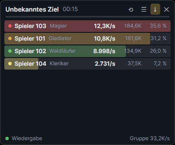

<p align="center">
  
</p>

<h1 align="center">AetherDPS</h1>

<p align="center">
  <b>Der kostenlose DPS-Meter und Begleiter für AION 2, für die EU-Server gebaut.</b><br />
  Ohne Abo, ohne Konto, ohne Werbung. Deine Kampfdaten bleiben auf deinem PC.<br />
  <sub>🌍 Deutsch · English · Français · Español · Português · Русский · 日本語 · 한국어 · 中文</sub>
</p>

<p align="center">
  <a href="https://github.com/yykk62/AetherDPS/releases/latest"><b>⬇ AetherDPS.exe herunterladen</b></a>
  ·
  <a href="#bedienung">Bedienung</a>
  ·
  <a href="#häufige-fragen">Häufige Fragen</a>
  ·
  <a href="#in-english">English</a>
</p>

<p align="center">
  
</p>

## Was kann der Meter?

| | |
|---|---|
| ⚔ **DPS-Meter** | Boss mit Lebensbalken, darunter Schaden, DPS, Anteil und Kampfkraft jedes Gruppenmitglieds. Skill-Details per Klick. Start mit STRG+W oder automatisch bei jedem Boss |
| 🗺 **Dungeons** | Der Meter erkennt, in welchem Dungeon du bist (mit Schwierigkeit), und benennt Läufe danach |
| 👥 **Nur deine Gruppe** | Fremde in der Nähe erscheinen nie. Beschwörungen zählen zu ihrem Besitzer. Tritt jemand bei, siehst du sofort Kampfkraft, Itemstufe, Verzauberung und Waffe |
| 🧙 **Profil** | Dein Charakter (oder jeder andere auf einem EU-Server) auch ohne laufendes Spiel: Ausrüstung mit Manasteinen und Götterstein, Werte, Daevanion, Titel, Skills |
| 🐾 **Pet-Finder** | Alle Pets mit deiner Stufe und einer Karte, wo ihre Monster spawnen, dazu deine Position |
| 🏆 **Läufe-Archiv** | Jeder Dungeon mit Boss-Zeiten, Bestzeit, Erfassungsquote und Kampfanalyse (inkl. erlittenem Schaden), als Bild oder Text kopierbar oder per Klick in deinen Discord-Kanal |
| ⏱ **Timer & Feldbosse** | Alle Feldbosse mit den echten Respawn-Zeiten des Servers (Karte im Spiel öffnen genügt), Risse, Artefakt-Belagerung, eigene Timer, mit Erinnerung und eigenem Overlay. Im Dungeon läuft das Zeitlimit mit |
| 💥 **Stagger & Tode** | Stagger-Leiste des Bosses mit Auswertung danach (wer hat wie viel beigetragen?). Nach deinem Tod: woran du gestorben bist |
| ✅ **Checkliste** | Tägliches und Wöchentliches mit automatischem Reset |
| 📶 **Verbindung** | Ping-Verlauf, Lag-Spitzen und eine Prüfung, ob das Problem bei dir, beim Anbieter oder beim Spielserver liegt |
| 🖼 **Screenshot** | STRG+S zeigt das Spielbild sofort auf deinem zweiten Monitor |
| 🌍 **10 Sprachen** | Oberfläche, Skills, Monster, Klassen, Dungeons und alle Servernamen in deiner Sprache |
| 🔄 **Updates** | Neue Versionen kommen von selbst, geprüft per Prüfsumme. Nach einem Spiel-Patch sagt dir der Meter Bescheid, statt einfach leer zu bleiben |

## Häufige Fragen

**Ist das erlaubt?** Der Meter liest den Netzwerkverkehr nur **passiv** mit, so wie die Spieltools anderer Anbieter auch. Er verändert nichts am Spiel, liest keinen Spielspeicher und sendet nichts ans Spiel. Es ist ein inoffizielles Fan-Projekt, nicht mit NCSOFT verbunden. Die Nutzung erfolgt auf eigene Verantwortung.

**Was kostet das?** Nichts. Der Quellcode ist offen (GPL-3.0), jeder kann nachsehen, was das Programm tut.

**Werden meine Daten hochgeladen?** Deine Kampfdaten, Läufe und Mitschnitte nie. Es gibt kein Konto und keine Bestenliste. Nach außen geht nur:
- die **Update-Prüfung** und das Lesen von Neuigkeiten auf GitHub (es wird nichts gesendet),
- eine **anonyme Nutzungszahl**, nur wenn du beim ersten Start zustimmst: einmal am Tag `{"v":"0.6.0","lang":"de","new":false}`, also Version, Sprache und ob es die erste Nutzung ist. Keine Namen, kein Server, keine Kennung. Jederzeit abschaltbar unter Einstellungen → Datenschutz,
- **Fehlerberichte**, nur wenn du selbst auf „Senden“ klickst. Namen von Spielern werden vorher entfernt, und du siehst vorher, was rausgeht.
- **Charakter-Profile** von NCSOFT (dieselben öffentlichen Daten wie auf aion2.plaync.com): wenn du den Reiter Profil öffnest (dein Charakter), auf jemanden klickst oder sucht, und – abschaltbar im Reiter Gruppe – wenn jemand deiner Gruppe beitritt. Dabei gehen nur Name und Server an NCSOFT.

Der Server dafür ist offen einsehbar im Ordner [`server/`](server/) und speichert keine IP-Adressen.

**Warum warnt Windows beim ersten Start?** Die Datei ist noch nicht digital signiert, das ist in Arbeit. Klick auf „Weitere Informationen“ → „Trotzdem ausführen“.

**Was ist Npcap?** Ein kostenloser Treiber, mit dem Programme den Netzwerkverkehr mitlesen können (auch Wireshark nutzt ihn). Der Meter richtet ihn beim ersten Start mit einem Klick ein.

**Etwas stimmt nicht?** Hauptfenster oder Tray-Symbol → „Problem melden“. Kurz beschreiben, Senden klicken, fertig. Kein Konto und keine E-Mail nötig. Alternativ ein [Issue auf GitHub öffnen](https://github.com/yykk62/AetherDPS/issues).

**Nach einem Spiel-Patch zeigt der Meter nichts mehr?** Das passiert, wenn sich die Daten des Spiels ändern. Der Meter erkennt das und sagt Bescheid. Die angepasste Version kommt meist schnell und installiert sich von selbst.

## Download

**[AetherDPS.exe von der Release-Seite laden](https://github.com/yykk62/AetherDPS/releases/latest)**: eine einzige Datei, keine Installation und kein .NET nötig.

- **Voraussetzung:** Windows 10 oder 11 (64 Bit) und Npcap (richtet der Meter beim ersten Start selbst ein)
- **Wohin damit?** In einen eigenen Ordner, zum Beispiel `Dokumente\AetherDPS`, nicht in den Download-Ordner und nicht nach `C:\Programme` (dort darf sich die Datei nicht selbst aktualisieren)
- **Windows-Warnung „Der Computer wurde durch Windows geschützt“:** Die Datei ist noch nicht digital signiert. Auf „Weitere Informationen“ → „Trotzdem ausführen“ klicken. Wer sichergehen will, vergleicht die SHA-256-Prüfsumme mit der Angabe auf der Release-Seite: `Get-FileHash AetherDPS.exe`
- **Updates kommen automatisch:** Der Meter sieht bei jedem Start auf GitHub nach und installiert eine neue Version gleich dort (er startet kurz neu). Läuft er länger, schaut er stündlich nach und installiert beim nächsten Start. Abschaltbar unter Einstellungen → Updates. Dabei wird nur die öffentliche Release-Seite abgefragt, von dir wird nichts gesendet

## Installation

1. AetherDPS starten.
2. Fehlt **Npcap**, öffnet sich die Einrichtung. Dort einmal auf „Npcap jetzt installieren“ klicken. Der Meter lädt Npcap von der offiziellen Seite, prüft die Signatur und startet den Installer mit den richtigen Einstellungen. Du bestätigst nur noch (Admin-Abfrage → „Ja“, dann „I Agree“ → „Install“ → „Finish“).
3. AION 2 starten und einloggen. Das Overlay findet die Verbindung von selbst.

Die Einstellungen, die Kampf-Historie, die Logs und die Mitschnitte liegen unter `%LOCALAPPDATA%\AetherDPS`.

## Bedienung

**Reiter im Hauptfenster:**
- **DPS-Meter:** Status und aktueller Lauf
- **Läufe:** Archiv aller Läufe mit Boss-Zeiten, Bestzeit 🏆, Vergleich mit deinem Durchschnitt, Kampfanalyse pro Spieler (Aktivität, Tode, Skills, Buff-Laufzeit) sowie „Als Bild/Text kopieren“ für Discord
- **Gruppe:** Mitglieder mit Server, Stufe und Kampfkraft (nur für dich sichtbar)
- **Timer:** Zeitpläne für Risse, Weltbosse und Events (Wochentage + Uhrzeiten oder Takt, selbst anlegbar), Feldboss-Timer (Kill wird automatisch erkannt), eigene Countdowns, jeweils mit Erinnerung. Dazu ein eigenes **Timer-Overlay**, unabhängig vom DPS-Meter: verschiebbar, skalierbar und sperrbar, Klick führt zum Bearbeiten
- **Checkliste:** Tägliches und Wöchentliches mit automatischem Reset und Erinnerung
- **Verbindung** und **Einstellungen**

Dazu kommt eine **Buff-Leiste** unter dem Meter mit deinen Buffs (gold) und Abklingzeiten (blau).

Beim Start öffnet sich das **Hauptfenster** mit den Reitern DPS-Meter, Verbindung und Einstellungen. Wer es schließt, lässt den Meter im Tray weiterlaufen. Der Reiter **Verbindung** zeigt deinen Spiel-Ping als Verlauf mit Lag-Spitzen und neu gesendeten Paketen. „Verbindung prüfen“ sagt dir, ob ein Problem im Heimnetz, beim Internetanbieter oder auf dem Weg zum Spielserver liegt.

| Was | Wie |
|---|---|
| Meter starten / ausblenden | **STRG+W** im Spiel (in den Einstellungen änderbar). Ohne STRG+W ist der Meter in Bereitschaft und zeichnet keine Kämpfe auf |
| Automatisch erfassen | Einstellungen → „Automatisch erfassen“. Der Meter bleibt als schmale Leiste mit Name und Server stehen und klappt bei jedem Bosskampf von selbst auf. STRG+W blendet ihn dann nur ein und aus |
| Knöpfe | erscheinen, sobald die Maus über dem Meter ist |
| Verschieben | Boss-Karte oder Leiste ziehen |
| Breite ändern | rechten Rand ziehen. Die Höhe passt sich der Gruppe an |
| Gesamt / Ziel | Knopf oben. **Gesamt** = aller Schaden seit STRG+W, zum Beispiel ein ganzer Dungeon. **Ziel** = nur der aktuelle Gegner |
| Zurücksetzen | ⟲ |
| Ausblenden (Bereitschaft) | ✕. Ganz beenden über das Tray-Symbol → „Beenden“ |
| Skill-Details | ☰ oder auf einen Spieler klicken |
| Sperren (Mausklicks gehen ins Spiel, nichts wird versehentlich angeklickt) | Schloss-Symbol. Zum Entsperren wieder aufs Schloss klicken, es bleibt immer klickbar |
| Einstellungen | ⚙ oder Tray-Symbol: Hotkey ändern, Deckkraft, nur meine Gruppe (Standard: an), „Du“ statt Name |
| Screenshot auf den Zweitbildschirm | **STRG+S** im Spiel (änderbar). Der Spiel-Bildschirm erscheint im Vollbild auf dem anderen Monitor, jeder neue ersetzt das alte Bild. Klick oder ESC blendet aus |
| AION 2 starten | Knopf im Hauptfenster oder Einstellung „AION 2 mit dem Meter starten“ (Steam). Läuft der Meter beim Login schon, kennt er deinen Charakter sofort |
| Fehler melden | Hauptfenster oder Tray-Symbol → „Problem melden“ |
| Sprache | Einstellungen → Sprache (Standard: wie Windows) |

## Für Entwickler

```
dotnet build AetherDPS.slnx
dotnet test AetherDPS.Tests
dotnet test AetherDPS.UiTests      # rendert alle Fenster unsichtbar; AETHERDPS_SHOTS=<ordner> speichert Bilder
AetherDPS.App\bin\Debug\net10.0\AetherDPS.exe --replay <mitschnitt.txt> [--speed 1]
AetherDPS.Cli\bin\Debug\net10.0\aetherdps-cli.exe replay|demo <datei>
```

Aufbau und Wartung stehen in [docs/WARTUNG.md](docs/WARTUNG.md), das Protokoll in [docs/PROTOKOLL.md](docs/PROTOKOLL.md). Der kleine Server für Nutzungszahl und Fehlerberichte liegt in [`server/`](server/) (Cloudflare Worker), Nachrichten an alle stehen in [`status.json`](status.json).

**Release bauen:** `powershell -ExecutionPolicy Bypass -File tools\release.ps1` → `artifacts\release\AetherDPS.exe` + `.sha256`.
**Veröffentlichen:** Version in `AetherDPS.App.csproj` und `CHANGELOG.md` eintragen, dann `git tag v0.2.0` und `git push origin v0.2.0`. GitHub Actions baut, testet und legt das Release an.

## Danke an

Alle Quellen mit Lizenz stehen in [THIRD-PARTY-NOTICES.md](THIRD-PARTY-NOTICES.md). Besonders:


- **[RATmeter](https://github.com/Kuroukihime/AIon2-Dps-Meter)** von Kuroukihime (GPL-3.0): Netzwerkmitschnitt, Paketverarbeitung, Kampf-Sessions und die Mob-/Skill-Datenbank. Dieses Projekt ist ein Fork davon.
- **[A2Tools](https://github.com/taengu/A2Tools-DPS-Meter)** von taengu (GPL-3.0): Skill-, NPC-, Buff-, Dungeon- und Servernamen in 10 Sprachen sowie die Erkenntnis, wie man den Kartenwechsel (und damit den Dungeon) im Netzwerkverkehr erkennt
- **[Daevalog](https://github.com/Seralth/Daevalog)** von Seralth (GPL-3.0): Buff-Daten, über A2Tools übernommen
- **[aion2dps](https://github.com/TheLoop705/aion2dps)** (GPL-3.0+), **[Aion-DPS-Meter](https://github.com/SkeeveAN/Aion-DPS-Meter)** (MIT), **[waffle_meter](https://github.com/Waffle-ens/waffle_meter)** (MIT) und **[aion2-dps-meter](https://github.com/cyberbadger6969/aion2-dps-meter)** (GPL-3.0): Feldboss-Liste, EU-Respawn-Zeiten und Zeitlimit-Paket
- **[Aion-DPS-Meter](https://github.com/SkeeveAN/Aion-DPS-Meter)** von SkeeveTV (MIT): Pet-Daten, Spawnpunkte, Weltkarten und der Aufbau von Pet-Liste und Positions-Paket
- Klassen-Icons: © NCSOFT. Es sind die Icons aus AION 2, übernommen aus RATmeter und als Fan-Inhalt verwendet. Sie fallen nicht unter die GPL.

## In English

**AetherDPS** is a free, open-source DPS meter and companion overlay for AION 2, built for the EU servers and available in 10 languages (Settings → Language).

- **DPS meter** with boss card, damage, DPS, share and combat power for your party only, skill details, stagger analysis and death recap
- **Run archive** named after the dungeon, with boss times, best time and combat analysis, copyable for Discord
- **Profile** of your character (or anyone on an EU server) even without the game running: gear with manastones and godstone, stats, Daevanion, titles, skills. When someone joins your party, their combat power, item level and weapon pop up
- **Pet finder:** every pet with your level and a map of where its monsters spawn, plus your position
- **Field bosses with the server's real respawn times** (just open the map in game), rifts, Artifact Siege, dungeon time limit, **checklist**, **connection monitor**, **second-screen screenshot**, **post runs to Discord**
- **Automatic updates**, a warning after game patches, and **Report a problem** straight from the app

**Download:** [AetherDPS.exe](https://github.com/yykk62/AetherDPS/releases/latest), a single file with no installation needed (Windows 10/11, 64-bit). On first start it sets up Npcap with one click.

**Privacy:** your combat data never leaves your PC. The only outgoing data is the update check, an optional anonymous daily usage count (version and language only, opt-in), problem reports you send yourself and character profile lookups at NCSOFT (name and server only: when you open the Profile tab, look someone up, or – switchable – when someone joins your party). The server code is in [`server/`](server/).

**Is it allowed?** The meter only reads network traffic passively. It does not modify the game, read game memory or send anything to the game. It is an unofficial fan project, not affiliated with NCSOFT. Use at your own risk.

## Lizenz

GPL-3.0, siehe [LICENSE](LICENSE).
