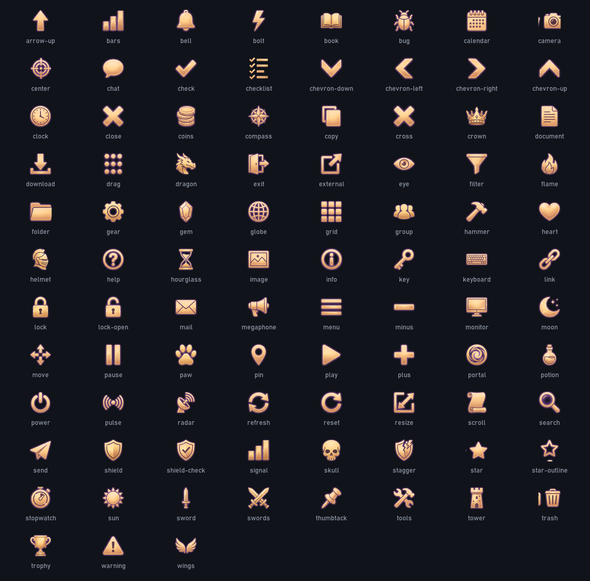
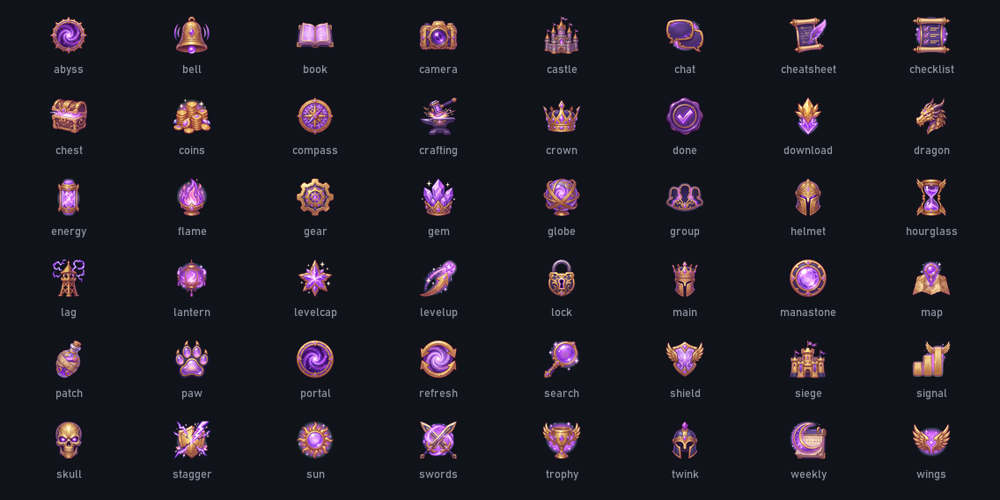

# AetherDPS – Grafik- und Icon-Set

Eigenes, durchgängiges Set für App, Webseite (aetherdps.com), README und Discord. Erzeugt mit Higgsfield
(nano_banana_2_1, 4k) als Raster-Sheets, lokal zerlegt und freigestellt. Stand 16.10.2026, 23 Generierungen.

## Marke

| | |
|---|---|
| Hintergrund `#10131a`, Fläche `#191e28`, Linie `#2c3442` | Gold `#e0a84a` (Akzent), Violett `#c9a8f2` |
| Text `#e6e8ec`, gedämpft `#8e96a3` | OK `#5cc26a`, Live/Rot `#e2554f` |

Logo: drei aufsteigende goldene Balken (`AetherDPS.App/Assets/icon.png`), Premium-Variante mit Daeva-Flügeln (`discord-bot/assets/avatar.webp`).
Schrift auf Grafiken: Bahnschrift, lokal gesetzt (`tools/icons/art.py`), nie aus der KI.

## UI-Icons (App) – Relief-Stil, 91 Stück

Gefüllte Goldglyphen mit violettem Schein, für 16–24 px gemacht. `icons/ui/<px>/<name>.png` in 16/20/24/32/48/64.
In der App: `Source="{l:Icon close, Size=12}"` (lädt automatisch die doppelte Auflösung) oder per Binding
`Converter={x:Static l:Icons.ByName}`. Die App bindet die Dateien direkt von hier ein (`AetherDPS.App.csproj`), keine Kopie.

## Embleme (Webseite, README) – 48 Stück

Gemalte Fantasy-Embleme für Feature-Kacheln, 24–128 px. `icons/emblem/<px>/<name>.png`.
Webseite: `<Icon name="swords" size={56} />` (`web/src/components/Icon.astro`, Dateien kommen per `sync-assets.mjs` nach `public/gen/brand`).
README: `docs/media/brand/icons/<name>.png` (48 px).

## Grafiken

| Datei | Zweck |
|---|---|
| `docs/media/brand/hero.webp` | Kopf-Banner im README (1600×400) |
| `docs/media/brand/banner-*.webp` | Abschnitts-Banner im README mit Titel (1600×200): meter, runs, profile, party, pets, timers, connection, checklist |
| `web/public/img/bg-aether.webp`, `bg-wings.webp`, `bg-stars.webp` | Abschnitts-Hintergründe der Startseite (1920 breit, sehr dunkel) |
| `web/public/img/divider.webp`, `docs/media/brand/divider.webp` | goldene Zierleiste (transparent) |
| `AetherDPS.App/Assets/art/hub-bg.jpg` | Wasserzeichen im Hauptfenster |
| `web/public/img/*.webp` (Seitenköpfe) | schon vorher vorhanden, gleicher Stil |

## Nachziehen

1. Sheet erzeugen (Higgsfield, 4k, einfarbiger Hintergrund: Schwarz für UI, Magenta `#FF00FF` für Embleme, Raster 5×5 bzw. 4×4,
   Referenzbild = ein vorhandenes Sheet, damit der Stil gleich bleibt). Prompts stehen in den Manifesten nicht; das Muster:
   „Icon sheet: a NxN grid … perfectly flat solid pure black background … no text … same style as the reference … Row 1: …“
2. 4k-PNG nach `sheets/` legen (bleibt lokal, `.gitignore`), Manifest `sheets/<name>.json` mit den Namen zeilenweise anlegen.
3. `python tools/icons/slice.py` – schneidet, stellt frei, skaliert, schreibt die 2k-WebP-Kopie und die Übersichten.
4. `python tools/icons/sync.py` – kopiert in den README-Ordner (`docs/media/brand`). Die Webseite holt sich die Embleme beim Bauen selbst.
5. Grafiken: Rohbilder als `art/raw-*.png` (lokal), dann `python tools/icons/art.py`.

Misslungene Einzel-Icons nicht einzeln neu würfeln, sondern gesammelt in einem Nachbesserungs-Sheet.
